# Results: CIFAR10

171 training runs, 18 scorer snapshots. Hardware: NVIDIA L40S. Target: ResNet-18, 60 epochs (equal-epochs setting). Accuracy in %, mean ± sample std over seeds; ci95 = half-width of the 95% t-interval.

## All settings

| setting | data_fraction | epochs | seeds | acc_mean | acc_std | ci95 | train_min |
|---|---|---|---|---|---|---|---|
| easy (EL2N, resnet18, e20) | 0.30 | 60 | 3 | 78.45 | 0.54 | 1.33 | 0.69 |
| easy (EL2N, resnet18, e20) | 0.50 | 60 | 3 | 85.53 | 0.28 | 0.70 | 1.11 |
| easy (EL2N, resnet18, e20) | 0.70 | 60 | 3 | 89.50 | 0.17 | 0.41 | 1.57 |
| easy (EL2N, resnet18, e20) | 0.90 | 60 | 3 | 92.38 | 0.15 | 0.37 | 1.98 |
| easy (EL2N, tiny, e20) | 0.30 | 60 | 3 | 73.13 | 0.30 | 0.74 | 0.68 |
| easy (EL2N, tiny, e20) | 0.50 | 60 | 3 | 81.07 | 0.26 | 0.64 | 1.11 |
| easy (EL2N, tiny, e20) | 0.70 | 60 | 3 | 87.13 | 0.22 | 0.55 | 1.57 |
| easy (EL2N, tiny, e20) | 0.90 | 60 | 3 | 92.26 | 0.18 | 0.44 | 1.96 |
| easy (forgetting, resnet18, e20) | 0.30 | 60 | 3 | 79.72 | 0.19 | 0.48 | 0.68 |
| easy (forgetting, resnet18, e20) | 0.50 | 60 | 3 | 85.42 | 0.51 | 1.28 | 1.11 |
| easy (forgetting, resnet18, e20) | 0.70 | 60 | 3 | 89.86 | 0.18 | 0.43 | 1.58 |
| easy (forgetting, resnet18, e20) | 0.90 | 60 | 3 | 93.25 | 0.21 | 0.52 | 1.99 |
| full data | 1.00 | 60 | 3 | 94.32 | 0.38 | 0.95 | 2.38 |
| hard (EL2N, resnet18, e1) | 0.30 | 60 | 3 | 66.73 | 1.42 | 3.52 | 0.66 |
| hard (EL2N, resnet18, e1) | 0.50 | 60 | 3 | 87.23 | 0.89 | 2.21 | 1.08 |
| hard (EL2N, resnet18, e1) | 0.70 | 60 | 3 | 92.61 | 0.12 | 0.30 | 1.50 |
| hard (EL2N, resnet18, e1) | 0.90 | 60 | 3 | 93.94 | 0.28 | 0.70 | 1.97 |
| hard (EL2N, resnet18, e20) | 0.30 | 60 | 3 | 80.15 | 0.64 | 1.58 | 0.69 |
| hard (EL2N, resnet18, e20) + distill | 0.30 | 60 | 3 | 90.44 | 0.52 | 1.29 | 0.80 |
| hard (EL2N, resnet18, e20) offset 0.05 | 0.30 | 60 | 3 | 85.76 | 1.05 | 2.62 | 0.69 |
| hard (EL2N, resnet18, e20) class-balanced | 0.30 | 60 | 3 | 80.98 | 1.22 | 3.02 | 0.76 |
| hard (EL2N, resnet18, e20) | 0.50 | 60 | 3 | 92.63 | 0.22 | 0.55 | 1.11 |
| hard (EL2N, resnet18, e20) + distill | 0.50 | 60 | 3 | 92.92 | 0.02 | 0.05 | 1.27 |
| hard (EL2N, resnet18, e20) offset 0.05 | 0.50 | 60 | 3 | 92.36 | 0.43 | 1.07 | 1.07 |
| hard (EL2N, resnet18, e20) class-balanced | 0.50 | 60 | 3 | 92.37 | 0.36 | 0.89 | 1.21 |
| hard (EL2N, resnet18, e20) | 0.70 | 60 | 3 | 94.09 | 0.22 | 0.55 | 1.55 |
| hard (EL2N, resnet18, e20) | 0.90 | 60 | 3 | 94.16 | 0.04 | 0.10 | 1.99 |
| hard (EL2N, resnet18, e5) | 0.30 | 60 | 3 | 74.40 | 3.86 | 9.59 | 0.66 |
| hard (EL2N, resnet18, e5) | 0.50 | 60 | 3 | 92.29 | 0.42 | 1.03 | 1.08 |
| hard (EL2N, resnet18, e5) | 0.70 | 60 | 3 | 93.93 | 0.36 | 0.91 | 1.49 |
| hard (EL2N, resnet18, e5) | 0.90 | 60 | 3 | 94.43 | 0.15 | 0.38 | 1.95 |
| hard (EL2N, tiny, e1) | 0.30 | 60 | 3 | 70.52 | 2.70 | 6.71 | 0.65 |
| hard (EL2N, tiny, e1) | 0.50 | 60 | 3 | 88.37 | 0.34 | 0.84 | 1.07 |
| hard (EL2N, tiny, e1) | 0.70 | 60 | 3 | 92.78 | 0.11 | 0.26 | 1.48 |
| hard (EL2N, tiny, e1) | 0.90 | 60 | 3 | 94.22 | 0.32 | 0.80 | 1.94 |
| hard (EL2N, tiny, e20) | 0.30 | 60 | 3 | 74.70 | 1.23 | 3.05 | 0.68 |
| hard (EL2N, tiny, e20) | 0.50 | 60 | 3 | 91.03 | 0.48 | 1.20 | 1.09 |
| hard (EL2N, tiny, e20) | 0.70 | 60 | 3 | 93.84 | 0.27 | 0.66 | 1.55 |
| hard (EL2N, tiny, e20) | 0.90 | 60 | 3 | 94.42 | 0.26 | 0.65 | 1.95 |
| hard (EL2N, tiny, e5) | 0.30 | 60 | 3 | 71.02 | 1.27 | 3.16 | 0.65 |
| hard (EL2N, tiny, e5) | 0.50 | 60 | 3 | 91.17 | 0.46 | 1.13 | 1.07 |
| hard (EL2N, tiny, e5) | 0.70 | 60 | 3 | 93.51 | 0.21 | 0.53 | 1.47 |
| hard (EL2N, tiny, e5) | 0.90 | 60 | 3 | 94.39 | 0.22 | 0.56 | 1.94 |
| hard (forgetting, resnet18, e20) | 0.30 | 60 | 3 | 81.81 | 5.65 | 14.02 | 0.68 |
| hard (forgetting, resnet18, e20) | 0.50 | 60 | 3 | 93.11 | 0.16 | 0.40 | 1.10 |
| hard (forgetting, resnet18, e20) | 0.70 | 60 | 3 | 93.88 | 0.20 | 0.48 | 1.58 |
| hard (forgetting, resnet18, e20) | 0.90 | 60 | 3 | 94.16 | 0.26 | 0.65 | 1.97 |
| random | 0.30 | 60 | 3 | 86.42 | 0.79 | 1.95 | 0.72 |
| random + distill | 0.30 | 60 | 3 | 89.09 | 0.36 | 0.89 | 0.70 |
| random | 0.50 | 60 | 3 | 90.97 | 0.30 | 0.74 | 1.14 |
| random + distill | 0.50 | 60 | 3 | 91.08 | 0.12 | 0.30 | 1.09 |
| random | 0.70 | 60 | 3 | 92.94 | 0.30 | 0.74 | 1.80 |
| random | 0.90 | 60 | 3 | 93.84 | 0.13 | 0.31 | 2.19 |
| short schedule | 1.00 | 18 | 3 | 91.29 | 0.84 | 2.09 | 0.62 |
| short schedule | 1.00 | 30 | 3 | 92.92 | 0.57 | 1.41 | 1.03 |
| short schedule | 1.00 | 42 | 3 | 93.99 | 0.04 | 0.10 | 1.73 |
| short schedule | 1.00 | 54 | 3 | 94.22 | 0.33 | 0.83 | 1.88 |

## Scoring cost

S = total GPU seconds of all scorer runs up to the snapshot (+ the EL2N forward pass). Pruning with equal epochs saves compute only if f < 1 - S/F (break-even f).

| score_set | scorer | epoch | runs | cost_sec | scorer_test_acc | S_over_F | break_even_f |
|---|---|---|---|---|---|---|---|
| el2n_resnet18_e1 | resnet18 | 1 | 3 | 56.580 | 39.457 | 0.396 | 0.604 |
| forget_resnet18_e1 | resnet18 | 1 | 3 | 44.650 | 39.457 | 0.312 | 0.688 |
| el2n_resnet18_e5 | resnet18 | 5 | 3 | 71.630 | 69.677 | 0.501 | 0.499 |
| forget_resnet18_e5 | resnet18 | 5 | 3 | 69.620 | 69.677 | 0.487 | 0.513 |
| el2n_resnet18_e20 | resnet18 | 20 | 3 | 165.770 | 84.083 | 1.159 | -0.159 |
| forget_resnet18_e20 | resnet18 | 20 | 3 | 163.760 | 84.083 | 1.145 | -0.145 |
| el2n_tiny_e1 | tiny | 1 | 3 | 11.380 | 48.677 | 0.080 | 0.920 |
| forget_tiny_e1 | tiny | 1 | 3 | 9.200 | 48.677 | 0.064 | 0.936 |
| el2n_tiny_e5 | tiny | 5 | 3 | 16.260 | 63.137 | 0.114 | 0.886 |
| forget_tiny_e5 | tiny | 5 | 3 | 16.130 | 63.137 | 0.113 | 0.887 |
| el2n_tiny_e20 | tiny | 20 | 3 | 42.280 | 63.580 | 0.296 | 0.704 |
| forget_tiny_e20 | tiny | 20 | 3 | 42.140 | 63.580 | 0.295 | 0.705 |

## Cost table (guide 10.7)

F = one full-data run = 2.38 min. total_pct < 100 means cheaper than training on all data.

| group | f | scoring_min | training_min | total_min | total_pct | acc_mean | acc_std | seeds |
|---|---|---|---|---|---|---|---|---|
| full data | 1.00 | 0.00 | 2.38 | 2.38 | 100.00 | 94.32 | 0.38 | 3 |
| short schedule | 0.90 | 0.00 | 1.88 | 1.88 | 78.96 | 94.22 | 0.33 | 3 |
| short schedule | 0.70 | 0.00 | 1.73 | 1.73 | 72.55 | 93.99 | 0.04 | 3 |
| short schedule | 0.50 | 0.00 | 1.03 | 1.03 | 43.19 | 92.92 | 0.57 | 3 |
| short schedule | 0.30 | 0.00 | 0.62 | 0.62 | 26.12 | 91.29 | 0.84 | 3 |
| random | 0.90 | 0.00 | 2.19 | 2.19 | 92.08 | 93.84 | 0.13 | 3 |
| random | 0.70 | 0.00 | 1.80 | 1.80 | 75.56 | 92.94 | 0.30 | 3 |
| random | 0.50 | 0.00 | 1.14 | 1.14 | 47.77 | 90.97 | 0.30 | 3 |
| random | 0.30 | 0.00 | 0.72 | 0.72 | 30.02 | 86.42 | 0.79 | 3 |
| easy (EL2N, resnet18, e20) | 0.90 | 2.76 | 1.98 | 4.74 | 199.08 | 92.38 | 0.15 | 3 |
| easy (EL2N, resnet18, e20) | 0.70 | 2.76 | 1.57 | 4.33 | 181.71 | 89.50 | 0.17 | 3 |
| easy (EL2N, resnet18, e20) | 0.50 | 2.76 | 1.11 | 3.87 | 162.57 | 85.53 | 0.28 | 3 |
| easy (EL2N, resnet18, e20) | 0.30 | 2.76 | 0.69 | 3.45 | 144.82 | 78.45 | 0.54 | 3 |
| easy (EL2N, tiny, e20) | 0.90 | 0.70 | 1.96 | 2.66 | 111.70 | 92.26 | 0.18 | 3 |
| easy (EL2N, tiny, e20) | 0.70 | 0.70 | 1.57 | 2.27 | 95.37 | 87.13 | 0.22 | 3 |
| easy (EL2N, tiny, e20) | 0.50 | 0.70 | 1.11 | 1.82 | 76.35 | 81.07 | 0.26 | 3 |
| easy (EL2N, tiny, e20) | 0.30 | 0.70 | 0.68 | 1.39 | 58.15 | 73.13 | 0.30 | 3 |
| easy (forgetting, resnet18, e20) | 0.90 | 2.73 | 1.99 | 4.71 | 197.84 | 93.25 | 0.21 | 3 |
| easy (forgetting, resnet18, e20) | 0.70 | 2.73 | 1.58 | 4.31 | 180.82 | 89.86 | 0.18 | 3 |
| easy (forgetting, resnet18, e20) | 0.50 | 2.73 | 1.11 | 3.84 | 161.03 | 85.42 | 0.51 | 3 |
| easy (forgetting, resnet18, e20) | 0.30 | 2.73 | 0.68 | 3.41 | 143.24 | 79.72 | 0.19 | 3 |
| hard (EL2N, resnet18, e1) | 0.90 | 0.94 | 1.97 | 2.91 | 122.07 | 93.94 | 0.28 | 3 |
| hard (EL2N, resnet18, e1) | 0.70 | 0.94 | 1.50 | 2.44 | 102.34 | 92.61 | 0.12 | 3 |
| hard (EL2N, resnet18, e1) | 0.50 | 0.94 | 1.08 | 2.03 | 85.00 | 87.23 | 0.89 | 3 |
| hard (EL2N, resnet18, e1) | 0.30 | 0.94 | 0.66 | 1.60 | 67.13 | 66.73 | 1.42 | 3 |
| hard (EL2N, resnet18, e20) | 0.90 | 2.76 | 1.99 | 4.76 | 199.64 | 94.16 | 0.04 | 3 |
| hard (EL2N, resnet18, e20) | 0.70 | 2.76 | 1.55 | 4.32 | 181.15 | 94.09 | 0.22 | 3 |
| hard (EL2N, resnet18, e20) | 0.50 | 2.76 | 1.11 | 3.87 | 162.52 | 92.63 | 0.22 | 3 |
| hard (EL2N, resnet18, e20) | 0.30 | 2.76 | 0.69 | 3.45 | 144.91 | 80.15 | 0.64 | 3 |
| hard (EL2N, resnet18, e20) + distill | 0.50 | 2.76 | 1.27 | 4.03 | 169.14 | 92.92 | 0.02 | 3 |
| hard (EL2N, resnet18, e20) + distill | 0.30 | 2.76 | 0.80 | 3.56 | 149.47 | 90.44 | 0.52 | 3 |
| hard (EL2N, resnet18, e20) class-balanced | 0.50 | 2.76 | 1.21 | 3.98 | 166.81 | 92.37 | 0.36 | 3 |
| hard (EL2N, resnet18, e20) class-balanced | 0.30 | 2.76 | 0.76 | 3.52 | 147.91 | 80.98 | 1.22 | 3 |
| hard (EL2N, resnet18, e20) offset 0.05 | 0.50 | 2.76 | 1.07 | 3.83 | 160.90 | 92.36 | 0.43 | 3 |
| hard (EL2N, resnet18, e20) offset 0.05 | 0.30 | 2.76 | 0.69 | 3.45 | 144.69 | 85.76 | 1.05 | 3 |
| hard (EL2N, resnet18, e5) | 0.90 | 1.19 | 1.95 | 3.14 | 131.95 | 94.43 | 0.15 | 3 |
| hard (EL2N, resnet18, e5) | 0.70 | 1.19 | 1.49 | 2.68 | 112.63 | 93.93 | 0.36 | 3 |
| hard (EL2N, resnet18, e5) | 0.50 | 1.19 | 1.08 | 2.27 | 95.21 | 92.29 | 0.42 | 3 |
| hard (EL2N, resnet18, e5) | 0.30 | 1.19 | 0.66 | 1.85 | 77.59 | 74.40 | 3.86 | 3 |
| hard (EL2N, tiny, e1) | 0.90 | 0.19 | 1.94 | 2.13 | 89.26 | 94.22 | 0.32 | 3 |
| hard (EL2N, tiny, e1) | 0.70 | 0.19 | 1.48 | 1.67 | 69.97 | 92.78 | 0.11 | 3 |
| hard (EL2N, tiny, e1) | 0.50 | 0.19 | 1.07 | 1.26 | 52.76 | 88.37 | 0.34 | 3 |
| hard (EL2N, tiny, e1) | 0.30 | 0.19 | 0.65 | 0.84 | 35.13 | 70.52 | 2.70 | 3 |
| hard (EL2N, tiny, e20) | 0.90 | 0.70 | 1.95 | 2.65 | 111.21 | 94.42 | 0.26 | 3 |
| hard (EL2N, tiny, e20) | 0.70 | 0.70 | 1.55 | 2.25 | 94.42 | 93.84 | 0.27 | 3 |
| hard (EL2N, tiny, e20) | 0.50 | 0.70 | 1.09 | 1.80 | 75.48 | 91.03 | 0.48 | 3 |
| hard (EL2N, tiny, e20) | 0.30 | 0.70 | 0.68 | 1.38 | 58.04 | 74.70 | 1.23 | 3 |
| hard (EL2N, tiny, e5) | 0.90 | 0.27 | 1.94 | 2.21 | 92.82 | 94.39 | 0.22 | 3 |
| hard (EL2N, tiny, e5) | 0.70 | 0.27 | 1.47 | 1.75 | 73.24 | 93.51 | 0.21 | 3 |
| hard (EL2N, tiny, e5) | 0.50 | 0.27 | 1.07 | 1.34 | 56.26 | 91.17 | 0.46 | 3 |
| hard (EL2N, tiny, e5) | 0.30 | 0.27 | 0.65 | 0.92 | 38.69 | 71.02 | 1.27 | 3 |
| hard (forgetting, resnet18, e20) | 0.90 | 2.73 | 1.97 | 4.70 | 197.32 | 94.16 | 0.26 | 3 |
| hard (forgetting, resnet18, e20) | 0.70 | 2.73 | 1.58 | 4.31 | 180.74 | 93.88 | 0.20 | 3 |
| hard (forgetting, resnet18, e20) | 0.50 | 2.73 | 1.10 | 3.83 | 160.81 | 93.11 | 0.16 | 3 |
| hard (forgetting, resnet18, e20) | 0.30 | 2.73 | 0.68 | 3.41 | 143.00 | 81.81 | 5.65 | 3 |
| random + distill | 0.50 | 2.76 | 1.09 | 3.86 | 161.87 | 91.08 | 0.12 | 3 |
| random + distill | 0.30 | 2.76 | 0.70 | 3.46 | 145.20 | 89.09 | 0.36 | 3 |

## Scorer agreement with the reference (guide 9.4)

Reference: el2n_resnet18_e20. Overlap = share of the reference's kept (hardest) images also kept by the other scorer; compare with random@f, the overlap expected by chance.

| score_set | spearman | kendall | overlap@90% | random@90% | overlap@70% | random@70% | overlap@50% | random@50% | overlap@30% | random@30% |
|---|---|---|---|---|---|---|---|---|---|---|
| el2n_tiny_e20 | 0.700 | 0.508 | 0.944 | 0.900 | 0.852 | 0.700 | 0.760 | 0.500 | 0.641 | 0.300 |
| el2n_resnet18_e5 | 0.670 | 0.481 | 0.936 | 0.900 | 0.841 | 0.700 | 0.747 | 0.500 | 0.631 | 0.300 |
| el2n_tiny_e5 | 0.615 | 0.434 | 0.932 | 0.900 | 0.826 | 0.700 | 0.722 | 0.500 | 0.593 | 0.300 |
| el2n_resnet18_e1 | 0.367 | 0.250 | 0.922 | 0.900 | 0.784 | 0.700 | 0.624 | 0.500 | 0.442 | 0.300 |
| el2n_tiny_e1 | 0.494 | 0.341 | 0.923 | 0.900 | 0.804 | 0.700 | 0.678 | 0.500 | 0.518 | 0.300 |
| forget_resnet18_e20 | 0.742 | 0.559 | 0.923 | 0.900 | 0.848 | 0.700 | 0.799 | 0.500 | 0.702 | 0.300 |
| forget_tiny_e20 | 0.653 | 0.479 | 0.923 | 0.900 | 0.845 | 0.700 | 0.756 | 0.500 | 0.590 | 0.300 |

## Scorer table (guide 9.5)

| scorer | epoch | runs | cost_sec | scorer_acc | spearman_vs_ref | hard_acc@50% | hard_acc@30% | random_acc@50% | random_acc@30% |
|---|---|---|---|---|---|---|---|---|---|
| resnet18 | 1 | 3 | 56.58 | 39.46 | 0.37 | 87.23 | 66.73 | 90.97 | 86.42 |
| resnet18 | 5 | 3 | 71.63 | 69.68 | 0.67 | 92.29 | 74.40 | 90.97 | 86.42 |
| resnet18 | 20 | 3 | 165.77 | 84.08 | 1.00 | 92.63 | 80.15 | 90.97 | 86.42 |
| tiny | 1 | 3 | 11.38 | 48.68 | 0.49 | 88.37 | 70.52 | 90.97 | 86.42 |
| tiny | 5 | 3 | 16.26 | 63.14 | 0.61 | 91.17 | 71.02 | 90.97 | 86.42 |
| tiny | 20 | 3 | 42.28 | 63.58 | 0.70 | 91.03 | 74.70 | 90.97 | 86.42 |

## Is it better than random? (Welch t-test, guide 12.4)

| setting | f | mean | random_mean | diff | t | p_value | significant_5pct |
|---|---|---|---|---|---|---|---|
| easy (EL2N, resnet18, e20) | 0.300 | 78.447 | 86.420 | -7.973 | -14.513 | 0.000 | yes |
| easy (EL2N, resnet18, e20) | 0.500 | 85.533 | 90.973 | -5.440 | -22.929 | 0.000 | yes |
| easy (EL2N, resnet18, e20) | 0.700 | 89.500 | 92.940 | -3.440 | -17.427 | 0.000 | yes |
| easy (EL2N, resnet18, e20) | 0.900 | 92.377 | 93.837 | -1.460 | -12.961 | 0.000 | yes |
| easy (EL2N, tiny, e20) | 0.300 | 73.130 | 86.420 | -13.290 | -27.367 | 0.000 | yes |
| easy (EL2N, tiny, e20) | 0.500 | 81.067 | 90.973 | -9.907 | -43.645 | 0.000 | yes |
| easy (EL2N, tiny, e20) | 0.700 | 87.133 | 92.940 | -5.807 | -27.100 | 0.000 | yes |
| easy (EL2N, tiny, e20) | 0.900 | 92.263 | 93.837 | -1.573 | -12.615 | 0.000 | yes |
| easy (forgetting, resnet18, e20) | 0.300 | 79.717 | 86.420 | -6.703 | -14.347 | 0.003 | yes |
| easy (forgetting, resnet18, e20) | 0.500 | 85.420 | 90.973 | -5.553 | -16.182 | 0.000 | yes |
| easy (forgetting, resnet18, e20) | 0.700 | 89.857 | 92.940 | -3.083 | -15.427 | 0.000 | yes |
| easy (forgetting, resnet18, e20) | 0.900 | 93.253 | 93.837 | -0.583 | -4.161 | 0.021 | yes |
| hard (EL2N, resnet18, e1) | 0.300 | 66.733 | 86.420 | -19.687 | -21.032 | 0.000 | yes |
| hard (EL2N, resnet18, e1) | 0.500 | 87.227 | 90.973 | -3.747 | -6.915 | 0.012 | yes |
| hard (EL2N, resnet18, e1) | 0.700 | 92.613 | 92.940 | -0.327 | -1.759 | 0.190 | no |
| hard (EL2N, resnet18, e1) | 0.900 | 93.937 | 93.837 | 0.100 | 0.562 | 0.616 | no |
| hard (EL2N, resnet18, e20) | 0.300 | 80.150 | 86.420 | -6.270 | -10.739 | 0.001 | yes |
| hard (EL2N, resnet18, e20) + distill | 0.300 | 90.437 | 86.420 | 4.017 | 7.391 | 0.003 | yes |
| hard (EL2N, resnet18, e20) offset 0.05 | 0.300 | 85.760 | 86.420 | -0.660 | -0.870 | 0.437 | no |
| hard (EL2N, resnet18, e20) class-balanced | 0.300 | 80.980 | 86.420 | -5.440 | -6.500 | 0.005 | yes |
| hard (EL2N, resnet18, e20) | 0.500 | 92.627 | 90.973 | 1.653 | 7.746 | 0.002 | yes |
| hard (EL2N, resnet18, e20) + distill | 0.500 | 92.923 | 90.973 | 1.950 | 11.330 | 0.007 | yes |
| hard (EL2N, resnet18, e20) offset 0.05 | 0.500 | 92.360 | 90.973 | 1.387 | 4.594 | 0.013 | yes |
| hard (EL2N, resnet18, e20) class-balanced | 0.500 | 92.370 | 90.973 | 1.397 | 5.187 | 0.007 | yes |
| hard (EL2N, resnet18, e20) | 0.700 | 94.090 | 92.940 | 1.150 | 5.360 | 0.007 | yes |
| hard (EL2N, resnet18, e20) | 0.900 | 94.163 | 93.837 | 0.327 | 4.293 | 0.035 | yes |
| hard (EL2N, resnet18, e5) | 0.300 | 74.400 | 86.420 | -12.020 | -5.284 | 0.029 | yes |
| hard (EL2N, resnet18, e5) | 0.500 | 92.290 | 90.973 | 1.317 | 4.461 | 0.014 | yes |
| hard (EL2N, resnet18, e5) | 0.700 | 93.933 | 92.940 | 0.993 | 3.650 | 0.023 | yes |
| hard (EL2N, resnet18, e5) | 0.900 | 94.430 | 93.837 | 0.593 | 5.235 | 0.007 | yes |
| hard (EL2N, tiny, e1) | 0.300 | 70.523 | 86.420 | -15.897 | -9.793 | 0.006 | yes |
| hard (EL2N, tiny, e1) | 0.500 | 88.373 | 90.973 | -2.600 | -10.028 | 0.001 | yes |
| hard (EL2N, tiny, e1) | 0.700 | 92.777 | 92.940 | -0.163 | -0.894 | 0.449 | no |
| hard (EL2N, tiny, e1) | 0.900 | 94.220 | 93.837 | 0.383 | 1.930 | 0.163 | no |
| hard (EL2N, tiny, e20) | 0.300 | 74.703 | 86.420 | -11.717 | -13.908 | 0.000 | yes |
| hard (EL2N, tiny, e20) | 0.500 | 91.030 | 90.973 | 0.057 | 0.173 | 0.873 | no |
| hard (EL2N, tiny, e20) | 0.700 | 93.837 | 92.940 | 0.897 | 3.881 | 0.018 | yes |
| hard (EL2N, tiny, e20) | 0.900 | 94.423 | 93.837 | 0.587 | 3.505 | 0.042 | yes |
| hard (EL2N, tiny, e5) | 0.300 | 71.017 | 86.420 | -15.403 | -17.842 | 0.000 | yes |
| hard (EL2N, tiny, e5) | 0.500 | 91.173 | 90.973 | 0.200 | 0.636 | 0.565 | no |
| hard (EL2N, tiny, e5) | 0.700 | 93.507 | 92.940 | 0.567 | 2.672 | 0.062 | no |
| hard (EL2N, tiny, e5) | 0.900 | 94.387 | 93.837 | 0.550 | 3.717 | 0.031 | yes |
| hard (forgetting, resnet18, e20) | 0.300 | 81.810 | 86.420 | -4.610 | -1.401 | 0.292 | no |
| hard (forgetting, resnet18, e20) | 0.500 | 93.107 | 90.973 | 2.133 | 10.898 | 0.001 | yes |
| hard (forgetting, resnet18, e20) | 0.700 | 93.880 | 92.940 | 0.940 | 4.563 | 0.015 | yes |
| hard (forgetting, resnet18, e20) | 0.900 | 94.160 | 93.837 | 0.323 | 1.941 | 0.151 | no |
| random + distill | 0.300 | 89.087 | 86.420 | 2.667 | 5.340 | 0.015 | yes |
| random + distill | 0.500 | 91.077 | 90.973 | 0.103 | 0.557 | 0.621 | no |

## Images kept per class (reference scores, guide 5.6)

| strategy | f | min_per_class | max_per_class | expected | class0 | class1 | class2 | class3 | class4 | class5 | class6 | class7 | class8 | class9 |
|---|---|---|---|---|---|---|---|---|---|---|---|---|---|---|
| hard | 90% | 3699 | 4944 | 4500 | 4788 | 3699 | 4602 | 4932 | 4730 | 4944 | 4795 | 4047 | 3973 | 4490 |
| easy | 90% | 3722 | 4844 | 4500 | 4573 | 4844 | 4504 | 3722 | 4500 | 4087 | 4501 | 4763 | 4799 | 4707 |
| hard | 70% | 2235 | 4531 | 3500 | 3836 | 2235 | 3566 | 4528 | 3944 | 4531 | 3857 | 2645 | 2617 | 3241 |
| easy | 70% | 2210 | 4334 | 3500 | 3575 | 4334 | 3476 | 2210 | 3279 | 2559 | 3439 | 4127 | 4159 | 3842 |
| hard | 50% | 1307 | 3823 | 2500 | 2621 | 1307 | 2532 | 3823 | 2912 | 3734 | 2666 | 1665 | 1631 | 2109 |
| easy | 50% | 1177 | 3693 | 2500 | 2379 | 3693 | 2468 | 1177 | 2088 | 1266 | 2334 | 3335 | 3369 | 2891 |
| hard | 30% | 666 | 2790 | 1500 | 1425 | 666 | 1524 | 2790 | 1721 | 2441 | 1561 | 873 | 841 | 1158 |
| easy | 30% | 469 | 2765 | 1500 | 1164 | 2765 | 1434 | 472 | 1056 | 469 | 1143 | 2355 | 2383 | 1759 |

## Figures

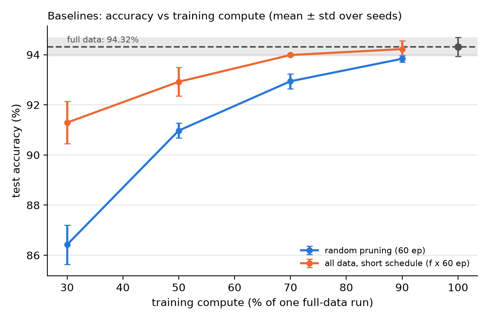
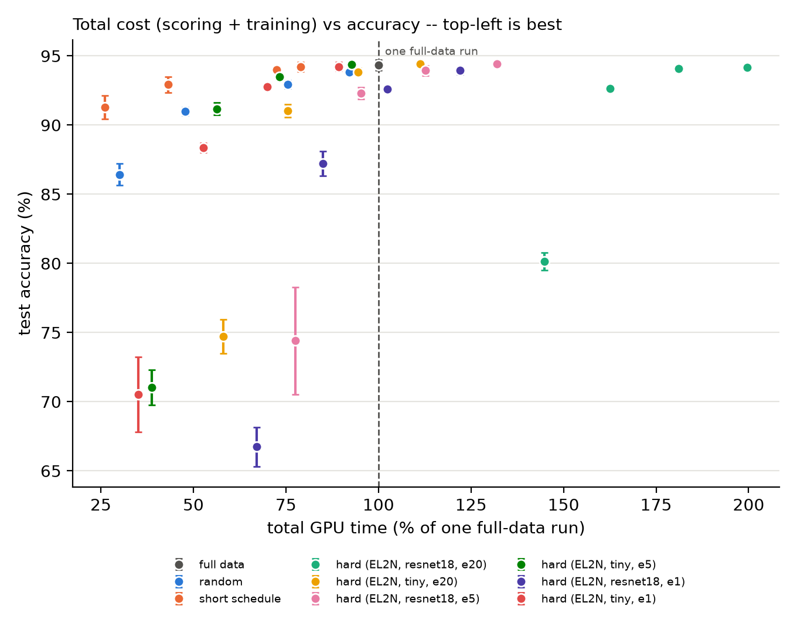
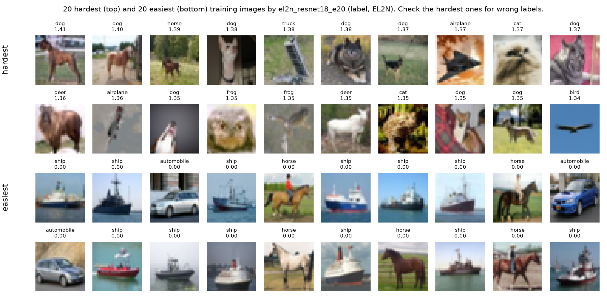
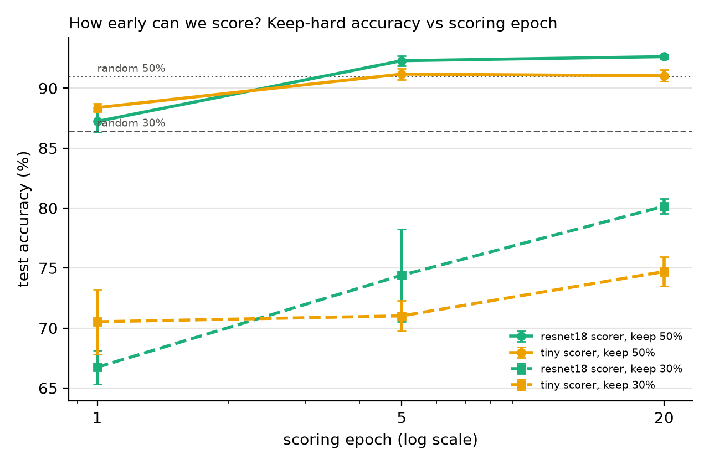
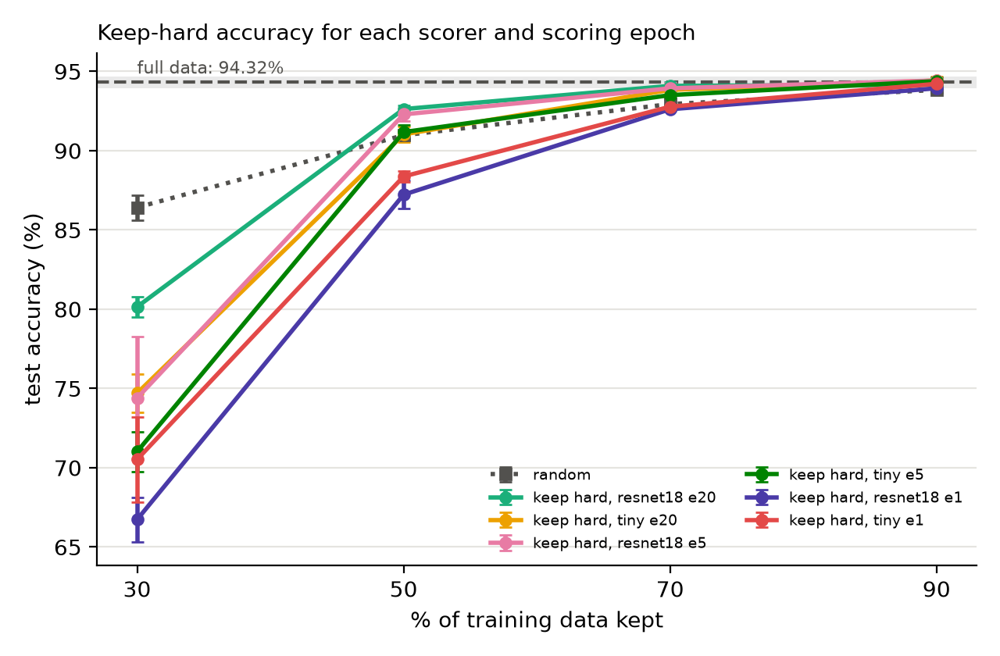
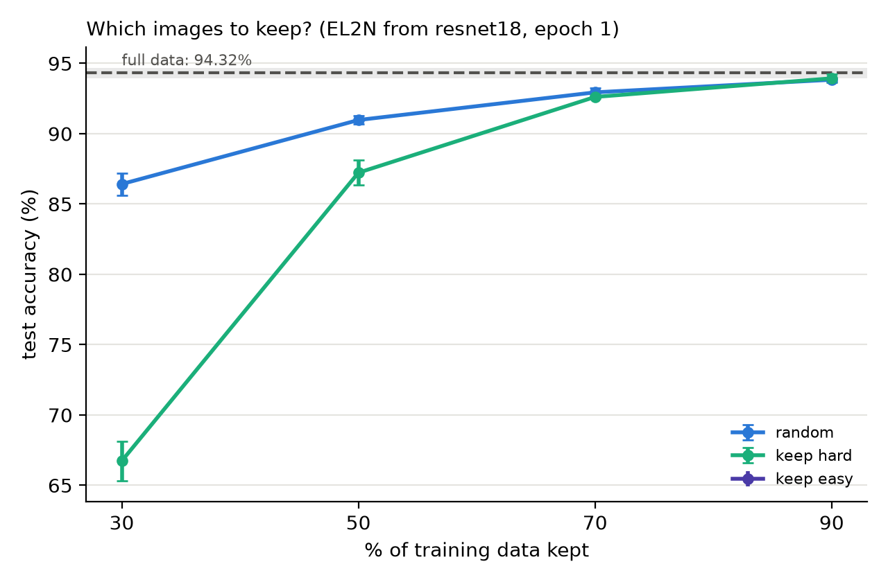
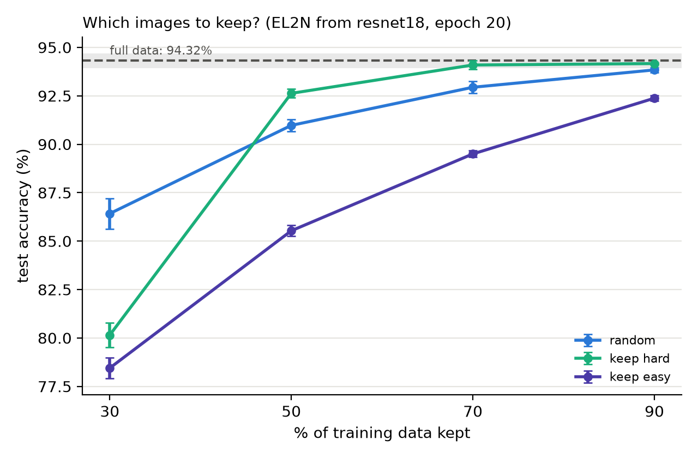
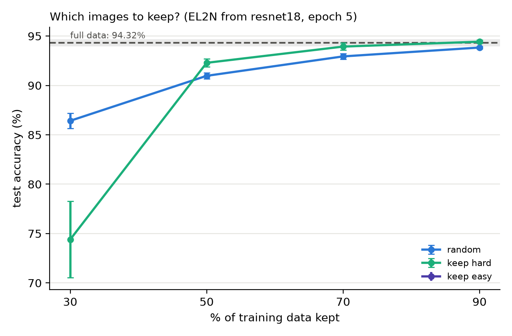
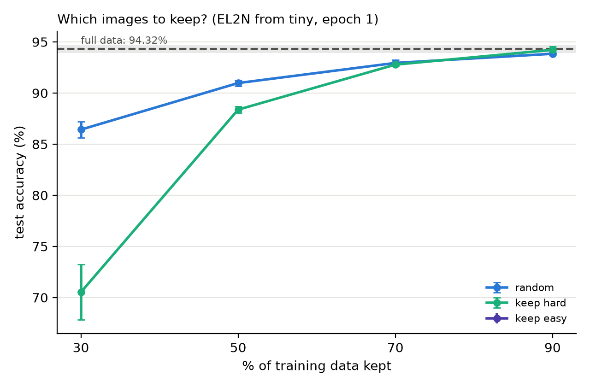
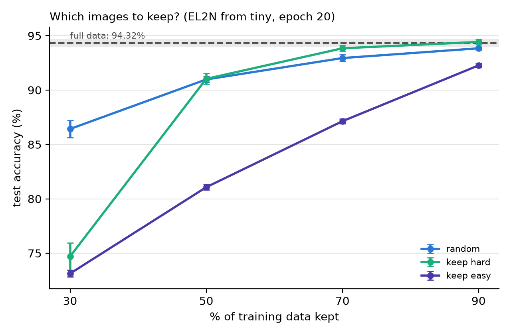
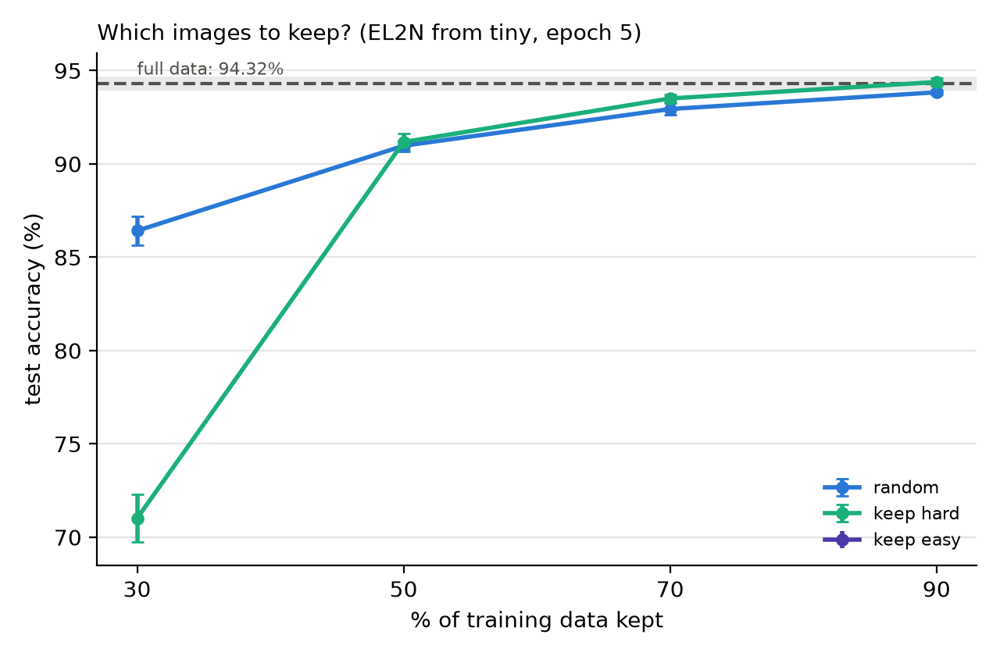
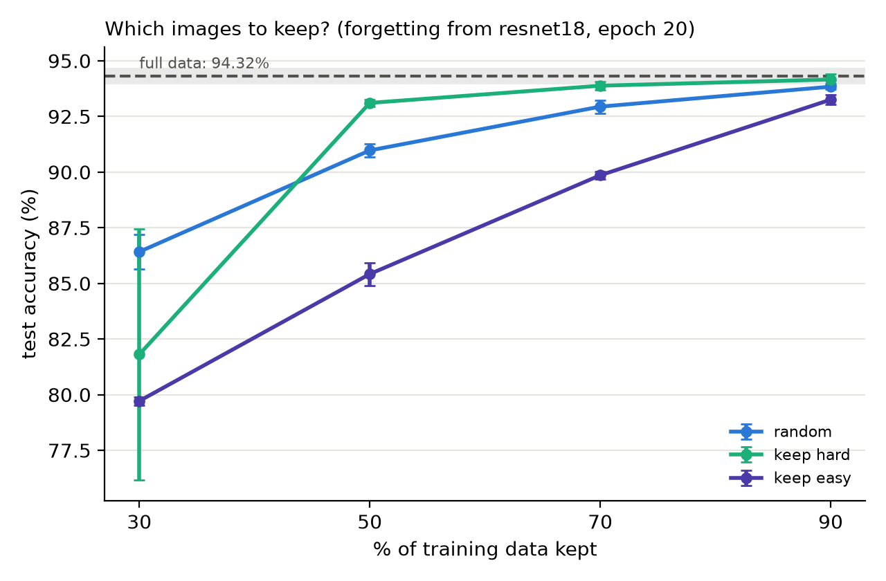
