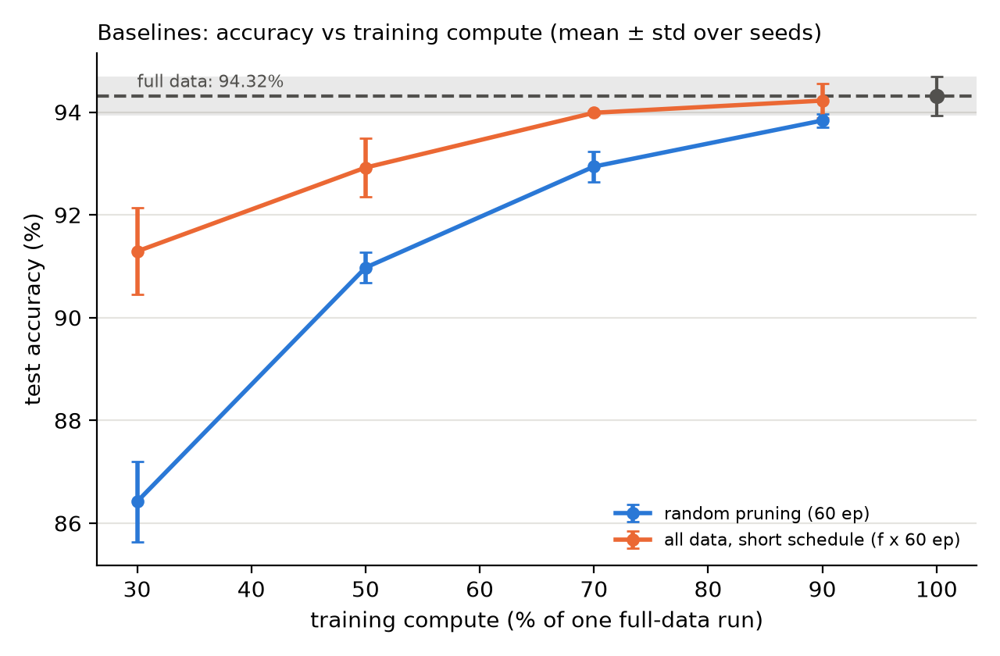
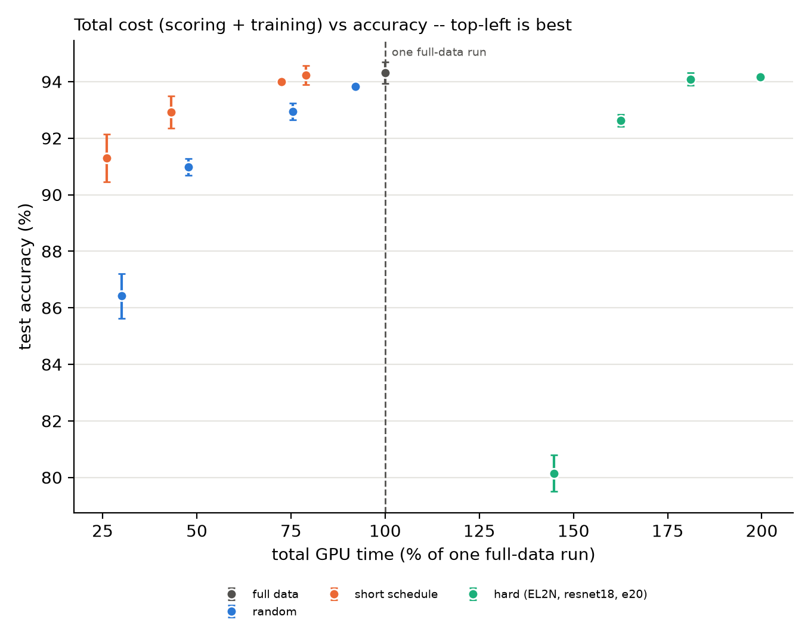
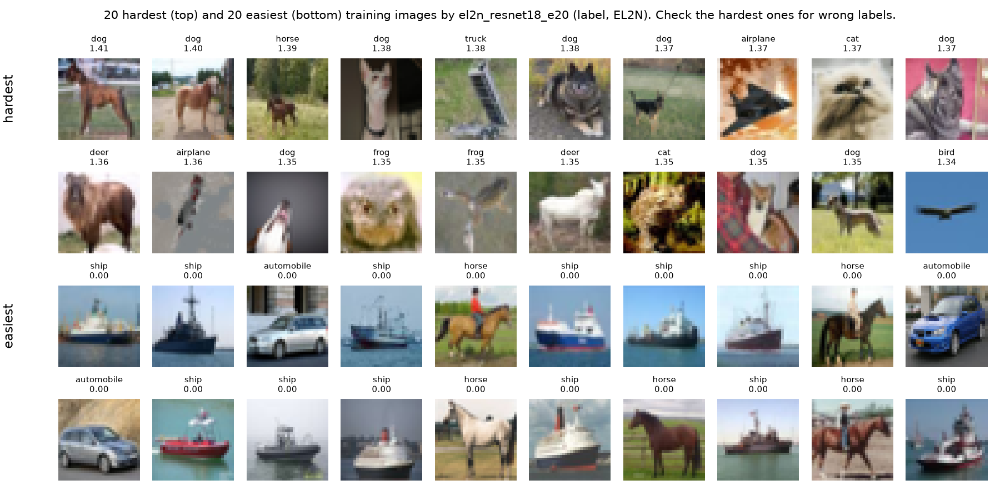
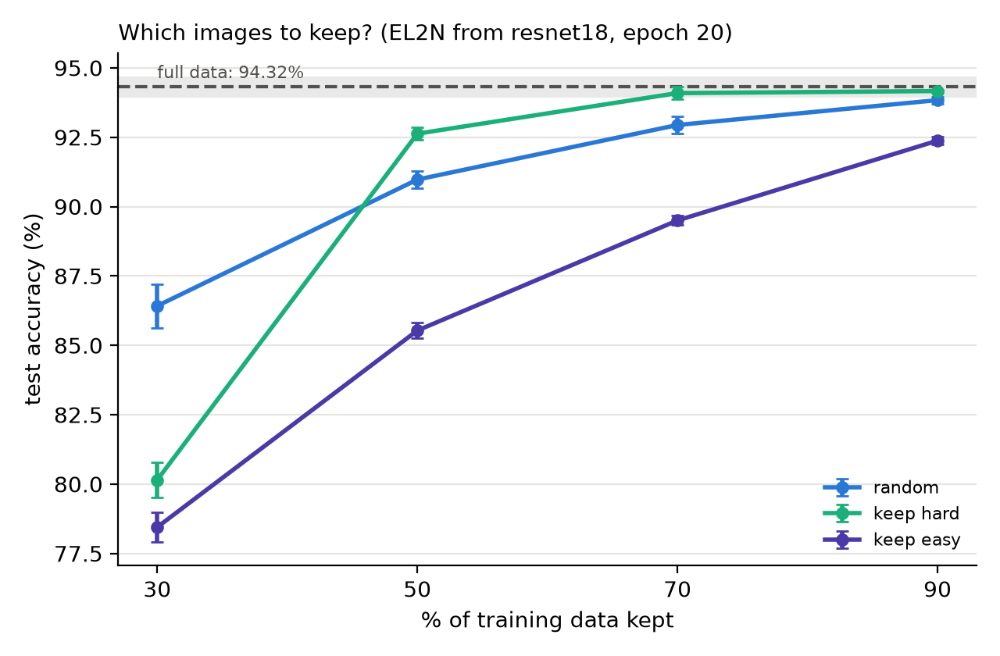

# Results: CIFAR10

51 training runs, 9 scorer snapshots. Hardware: NVIDIA L40S. Target: ResNet-18, 60 epochs (equal-epochs setting). Accuracy in %, mean ± sample std over seeds; ci95 = half-width of the 95% t-interval.

## All settings

| setting | data_fraction | epochs | seeds | acc_mean | acc_std | ci95 | train_min |
|---|---|---|---|---|---|---|---|
| easy (EL2N, resnet18, e20) | 0.30 | 60 | 3 | 78.45 | 0.54 | 1.33 | 0.69 |
| easy (EL2N, resnet18, e20) | 0.50 | 60 | 3 | 85.53 | 0.28 | 0.70 | 1.11 |
| easy (EL2N, resnet18, e20) | 0.70 | 60 | 3 | 89.50 | 0.17 | 0.41 | 1.57 |
| easy (EL2N, resnet18, e20) | 0.90 | 60 | 3 | 92.38 | 0.15 | 0.37 | 1.98 |
| full data | 1.00 | 60 | 3 | 94.32 | 0.38 | 0.95 | 2.38 |
| hard (EL2N, resnet18, e20) | 0.30 | 60 | 3 | 80.15 | 0.64 | 1.58 | 0.69 |
| hard (EL2N, resnet18, e20) | 0.50 | 60 | 3 | 92.63 | 0.22 | 0.55 | 1.11 |
| hard (EL2N, resnet18, e20) | 0.70 | 60 | 3 | 94.09 | 0.22 | 0.55 | 1.55 |
| hard (EL2N, resnet18, e20) | 0.90 | 60 | 3 | 94.16 | 0.04 | 0.10 | 1.99 |
| random | 0.30 | 60 | 3 | 86.42 | 0.79 | 1.95 | 0.72 |
| random | 0.50 | 60 | 3 | 90.97 | 0.30 | 0.74 | 1.14 |
| random | 0.70 | 60 | 3 | 92.94 | 0.30 | 0.74 | 1.80 |
| random | 0.90 | 60 | 3 | 93.84 | 0.13 | 0.31 | 2.19 |
| short schedule | 1.00 | 18 | 3 | 91.29 | 0.84 | 2.09 | 0.62 |
| short schedule | 1.00 | 30 | 3 | 92.92 | 0.57 | 1.41 | 1.03 |
| short schedule | 1.00 | 42 | 3 | 93.99 | 0.04 | 0.10 | 1.73 |
| short schedule | 1.00 | 54 | 3 | 94.22 | 0.33 | 0.83 | 1.88 |

## Scoring cost

S = total GPU seconds of all scorer runs up to the snapshot (+ the EL2N forward pass). Pruning with equal epochs saves compute only if f < 1 - S/F (break-even f).

| score_set | scorer | epoch | runs | cost_sec | scorer_test_acc | S_over_F | break_even_f |
|---|---|---|---|---|---|---|---|
| el2n_resnet18_e20 | resnet18 | 20 | 3 | 165.770 | 84.083 | 1.159 | -0.159 |

## Cost table (guide 10.7)

F = one full-data run = 2.38 min. total_pct < 100 means cheaper than training on all data.

| group | f | scoring_min | training_min | total_min | total_pct | acc_mean | acc_std | seeds |
|---|---|---|---|---|---|---|---|---|
| full data | 1.00 | 0.00 | 2.38 | 2.38 | 100.00 | 94.32 | 0.38 | 3 |
| short schedule | 0.90 | 0.00 | 1.88 | 1.88 | 78.96 | 94.22 | 0.33 | 3 |
| short schedule | 0.70 | 0.00 | 1.73 | 1.73 | 72.55 | 93.99 | 0.04 | 3 |
| short schedule | 0.50 | 0.00 | 1.03 | 1.03 | 43.19 | 92.92 | 0.57 | 3 |
| short schedule | 0.30 | 0.00 | 0.62 | 0.62 | 26.12 | 91.29 | 0.84 | 3 |
| random | 0.90 | 0.00 | 2.19 | 2.19 | 92.08 | 93.84 | 0.13 | 3 |
| random | 0.70 | 0.00 | 1.80 | 1.80 | 75.56 | 92.94 | 0.30 | 3 |
| random | 0.50 | 0.00 | 1.14 | 1.14 | 47.77 | 90.97 | 0.30 | 3 |
| random | 0.30 | 0.00 | 0.72 | 0.72 | 30.02 | 86.42 | 0.79 | 3 |
| easy (EL2N, resnet18, e20) | 0.90 | 2.76 | 1.98 | 4.74 | 199.08 | 92.38 | 0.15 | 3 |
| easy (EL2N, resnet18, e20) | 0.70 | 2.76 | 1.57 | 4.33 | 181.71 | 89.50 | 0.17 | 3 |
| easy (EL2N, resnet18, e20) | 0.50 | 2.76 | 1.11 | 3.87 | 162.57 | 85.53 | 0.28 | 3 |
| easy (EL2N, resnet18, e20) | 0.30 | 2.76 | 0.69 | 3.45 | 144.82 | 78.45 | 0.54 | 3 |
| hard (EL2N, resnet18, e20) | 0.90 | 2.76 | 1.99 | 4.76 | 199.64 | 94.16 | 0.04 | 3 |
| hard (EL2N, resnet18, e20) | 0.70 | 2.76 | 1.55 | 4.32 | 181.15 | 94.09 | 0.22 | 3 |
| hard (EL2N, resnet18, e20) | 0.50 | 2.76 | 1.11 | 3.87 | 162.52 | 92.63 | 0.22 | 3 |
| hard (EL2N, resnet18, e20) | 0.30 | 2.76 | 0.69 | 3.45 | 144.91 | 80.15 | 0.64 | 3 |

## Scorer table (guide 9.5)

| scorer | epoch | runs | cost_sec | scorer_acc | spearman_vs_ref | hard_acc@50% | hard_acc@30% | random_acc@50% | random_acc@30% |
|---|---|---|---|---|---|---|---|---|---|
| resnet18 | 20 | 3 | 165.77 | 84.08 | 1.00 | 92.63 | 80.15 | 90.97 | 86.42 |

## Is it better than random? (Welch t-test, guide 12.4)

| setting | f | mean | random_mean | diff | t | p_value | significant_5pct |
|---|---|---|---|---|---|---|---|
| easy (EL2N, resnet18, e20) | 0.300 | 78.447 | 86.420 | -7.973 | -14.513 | 0.000 | yes |
| easy (EL2N, resnet18, e20) | 0.500 | 85.533 | 90.973 | -5.440 | -22.929 | 0.000 | yes |
| easy (EL2N, resnet18, e20) | 0.700 | 89.500 | 92.940 | -3.440 | -17.427 | 0.000 | yes |
| easy (EL2N, resnet18, e20) | 0.900 | 92.377 | 93.837 | -1.460 | -12.961 | 0.000 | yes |
| hard (EL2N, resnet18, e20) | 0.300 | 80.150 | 86.420 | -6.270 | -10.739 | 0.001 | yes |
| hard (EL2N, resnet18, e20) | 0.500 | 92.627 | 90.973 | 1.653 | 7.746 | 0.002 | yes |
| hard (EL2N, resnet18, e20) | 0.700 | 94.090 | 92.940 | 1.150 | 5.360 | 0.007 | yes |
| hard (EL2N, resnet18, e20) | 0.900 | 94.163 | 93.837 | 0.327 | 4.293 | 0.035 | yes |

## Images kept per class (reference scores, guide 5.6)

| strategy | f | min_per_class | max_per_class | expected | class0 | class1 | class2 | class3 | class4 | class5 | class6 | class7 | class8 | class9 |
|---|---|---|---|---|---|---|---|---|---|---|---|---|---|---|
| hard | 90% | 3699 | 4944 | 4500 | 4788 | 3699 | 4602 | 4932 | 4730 | 4944 | 4795 | 4047 | 3973 | 4490 |
| easy | 90% | 3722 | 4844 | 4500 | 4573 | 4844 | 4504 | 3722 | 4500 | 4087 | 4501 | 4763 | 4799 | 4707 |
| hard | 70% | 2235 | 4531 | 3500 | 3836 | 2235 | 3566 | 4528 | 3944 | 4531 | 3857 | 2645 | 2617 | 3241 |
| easy | 70% | 2210 | 4334 | 3500 | 3575 | 4334 | 3476 | 2210 | 3279 | 2559 | 3439 | 4127 | 4159 | 3842 |
| hard | 50% | 1307 | 3823 | 2500 | 2621 | 1307 | 2532 | 3823 | 2912 | 3734 | 2666 | 1665 | 1631 | 2109 |
| easy | 50% | 1177 | 3693 | 2500 | 2379 | 3693 | 2468 | 1177 | 2088 | 1266 | 2334 | 3335 | 3369 | 2891 |
| hard | 30% | 666 | 2790 | 1500 | 1425 | 666 | 1524 | 2790 | 1721 | 2441 | 1561 | 873 | 841 | 1158 |
| easy | 30% | 469 | 2765 | 1500 | 1164 | 2765 | 1434 | 472 | 1056 | 469 | 1143 | 2355 | 2383 | 1759 |

## Figures

