# Results: CIFAR100

123 training runs, 18 scorer snapshots. Hardware: NVIDIA L40S. Target: ResNet-18, 60 epochs (equal-epochs setting). Accuracy in %, mean ± sample std over seeds; ci95 = half-width of the 95% t-interval.

## All settings

| setting | data_fraction | epochs | seeds | acc_mean | acc_std | ci95 | train_min |
|---|---|---|---|---|---|---|---|
| easy (EL2N, resnet18, e20) | 0.30 | 60 | 3 | 54.16 | 0.73 | 1.81 | 0.67 |
| easy (EL2N, resnet18, e20) | 0.50 | 60 | 3 | 64.80 | 0.45 | 1.13 | 1.10 |
| easy (EL2N, resnet18, e20) | 0.70 | 60 | 3 | 69.89 | 0.18 | 0.45 | 1.55 |
| easy (EL2N, resnet18, e20) | 0.90 | 60 | 3 | 75.13 | 0.31 | 0.78 | 1.94 |
| easy (EL2N, tiny, e20) | 0.30 | 60 | 3 | 47.89 | 0.55 | 1.38 | 0.68 |
| easy (EL2N, tiny, e20) | 0.50 | 60 | 3 | 60.36 | 0.28 | 0.70 | 1.12 |
| easy (EL2N, tiny, e20) | 0.70 | 60 | 3 | 68.01 | 0.34 | 0.86 | 1.58 |
| easy (EL2N, tiny, e20) | 0.90 | 60 | 3 | 74.13 | 0.32 | 0.79 | 1.95 |
| full data | 1.00 | 60 | 3 | 76.34 | 0.16 | 0.40 | 2.17 |
| hard (EL2N, resnet18, e1) | 0.30 | 60 | 3 | 49.86 | 1.78 | 4.42 | 0.71 |
| hard (EL2N, resnet18, e1) | 0.50 | 60 | 3 | 62.45 | 1.01 | 2.51 | 1.25 |
| hard (EL2N, resnet18, e1) | 0.70 | 60 | 3 | 70.47 | 0.24 | 0.59 | 1.64 |
| hard (EL2N, resnet18, e1) | 0.90 | 60 | 3 | 75.16 | 0.11 | 0.27 | 2.13 |
| hard (EL2N, resnet18, e20) | 0.30 | 60 | 3 | 31.06 | 4.95 | 12.30 | 0.69 |
| hard (EL2N, resnet18, e20) | 0.50 | 60 | 3 | 60.57 | 1.82 | 4.53 | 1.12 |
| hard (EL2N, resnet18, e20) | 0.70 | 60 | 3 | 72.53 | 1.77 | 4.40 | 1.57 |
| hard (EL2N, resnet18, e20) | 0.90 | 60 | 3 | 75.81 | 0.67 | 1.67 | 1.98 |
| hard (EL2N, resnet18, e5) | 0.30 | 60 | 3 | 34.56 | 2.35 | 5.84 | 0.71 |
| hard (EL2N, resnet18, e5) | 0.50 | 60 | 3 | 61.24 | 0.46 | 1.13 | 1.27 |
| hard (EL2N, resnet18, e5) | 0.70 | 60 | 3 | 72.29 | 0.30 | 0.73 | 1.67 |
| hard (EL2N, resnet18, e5) | 0.90 | 60 | 3 | 75.52 | 0.26 | 0.64 | 2.10 |
| hard (EL2N, tiny, e1) | 0.30 | 60 | 3 | 44.26 | 1.48 | 3.67 | 0.92 |
| hard (EL2N, tiny, e1) | 0.50 | 60 | 3 | 61.73 | 1.35 | 3.34 | 1.20 |
| hard (EL2N, tiny, e1) | 0.70 | 60 | 3 | 70.63 | 0.57 | 1.41 | 1.78 |
| hard (EL2N, tiny, e1) | 0.90 | 60 | 3 | 74.72 | 0.60 | 1.49 | 2.34 |
| hard (EL2N, tiny, e20) | 0.30 | 60 | 3 | 37.77 | 3.21 | 7.97 | 0.68 |
| hard (EL2N, tiny, e20) | 0.50 | 60 | 3 | 62.03 | 0.38 | 0.94 | 1.10 |
| hard (EL2N, tiny, e20) | 0.70 | 60 | 3 | 72.94 | 0.37 | 0.92 | 1.56 |
| hard (EL2N, tiny, e20) | 0.90 | 60 | 3 | 76.34 | 0.05 | 0.12 | 1.96 |
| hard (EL2N, tiny, e5) | 0.30 | 60 | 3 | 40.86 | 2.68 | 6.66 | 0.92 |
| hard (EL2N, tiny, e5) | 0.50 | 60 | 3 | 61.75 | 0.67 | 1.66 | 1.23 |
| hard (EL2N, tiny, e5) | 0.70 | 60 | 3 | 71.14 | 0.34 | 0.85 | 1.81 |
| hard (EL2N, tiny, e5) | 0.90 | 60 | 3 | 75.27 | 0.62 | 1.55 | 2.34 |
| random | 0.30 | 60 | 3 | 58.07 | 0.39 | 0.96 | 0.71 |
| random | 0.50 | 60 | 3 | 68.26 | 0.28 | 0.70 | 1.14 |
| random | 0.70 | 60 | 3 | 72.33 | 0.30 | 0.75 | 1.58 |
| random | 0.90 | 60 | 3 | 75.17 | 0.71 | 1.76 | 1.99 |
| short schedule | 1.00 | 18 | 3 | 72.28 | 0.71 | 1.76 | 0.62 |
| short schedule | 1.00 | 30 | 3 | 74.14 | 0.59 | 1.47 | 1.04 |
| short schedule | 1.00 | 42 | 3 | 75.51 | 0.43 | 1.06 | 1.51 |
| short schedule | 1.00 | 54 | 3 | 75.94 | 0.41 | 1.03 | 1.89 |

## Scoring cost

S = total GPU seconds of all scorer runs up to the snapshot (+ the EL2N forward pass). Pruning with equal epochs saves compute only if f < 1 - S/F (break-even f).

| score_set | scorer | epoch | runs | cost_sec | scorer_test_acc | S_over_F | break_even_f |
|---|---|---|---|---|---|---|---|
| el2n_resnet18_e1 | resnet18 | 1 | 3 | 218.580 | 13.637 | 1.681 | -0.681 |
| forget_resnet18_e1 | resnet18 | 1 | 3 | 203.010 | 13.637 | 1.561 | -0.561 |
| el2n_resnet18_e5 | resnet18 | 5 | 3 | 233.330 | 43.197 | 1.795 | -0.795 |
| forget_resnet18_e5 | resnet18 | 5 | 3 | 228.330 | 43.197 | 1.756 | -0.756 |
| el2n_resnet18_e20 | resnet18 | 20 | 3 | 327.090 | 60.313 | 2.516 | -1.516 |
| forget_resnet18_e20 | resnet18 | 20 | 3 | 323.160 | 60.313 | 2.485 | -1.485 |
| el2n_tiny_e1 | tiny | 1 | 3 | 67.010 | 17.063 | 0.515 | 0.485 |
| forget_tiny_e1 | tiny | 1 | 3 | 63.340 | 17.063 | 0.487 | 0.513 |
| el2n_tiny_e5 | tiny | 5 | 3 | 71.880 | 30.727 | 0.553 | 0.447 |
| forget_tiny_e5 | tiny | 5 | 3 | 70.480 | 30.727 | 0.542 | 0.458 |
| el2n_tiny_e20 | tiny | 20 | 3 | 99.950 | 39.893 | 0.769 | 0.231 |
| forget_tiny_e20 | tiny | 20 | 3 | 98.960 | 39.893 | 0.761 | 0.239 |

## Cost table (guide 10.7)

F = one full-data run = 2.17 min. total_pct < 100 means cheaper than training on all data.

| group | f | scoring_min | training_min | total_min | total_pct | acc_mean | acc_std | seeds |
|---|---|---|---|---|---|---|---|---|
| full data | 1.00 | 0.00 | 2.17 | 2.17 | 100.00 | 76.34 | 0.16 | 3 |
| short schedule | 0.90 | 0.00 | 1.89 | 1.89 | 87.34 | 75.94 | 0.41 | 3 |
| short schedule | 0.70 | 0.00 | 1.51 | 1.51 | 69.85 | 75.51 | 0.43 | 3 |
| short schedule | 0.50 | 0.00 | 1.04 | 1.04 | 47.80 | 74.14 | 0.59 | 3 |
| short schedule | 0.30 | 0.00 | 0.62 | 0.62 | 28.43 | 72.28 | 0.71 | 3 |
| random | 0.90 | 0.00 | 1.99 | 1.99 | 91.60 | 75.17 | 0.71 | 3 |
| random | 0.70 | 0.00 | 1.58 | 1.58 | 72.74 | 72.33 | 0.30 | 3 |
| random | 0.50 | 0.00 | 1.14 | 1.14 | 52.46 | 68.26 | 0.28 | 3 |
| random | 0.30 | 0.00 | 0.71 | 0.71 | 32.75 | 58.07 | 0.39 | 3 |
| easy (EL2N, resnet18, e20) | 0.90 | 5.45 | 1.94 | 7.39 | 340.95 | 75.13 | 0.31 | 3 |
| easy (EL2N, resnet18, e20) | 0.70 | 5.45 | 1.55 | 7.00 | 323.00 | 69.89 | 0.18 | 3 |
| easy (EL2N, resnet18, e20) | 0.50 | 5.45 | 1.10 | 6.55 | 302.14 | 64.80 | 0.45 | 3 |
| easy (EL2N, resnet18, e20) | 0.30 | 5.45 | 0.67 | 6.13 | 282.66 | 54.16 | 0.73 | 3 |
| easy (EL2N, tiny, e20) | 0.90 | 1.67 | 1.95 | 3.62 | 167.08 | 74.13 | 0.32 | 3 |
| easy (EL2N, tiny, e20) | 0.70 | 1.67 | 1.58 | 3.24 | 149.68 | 68.01 | 0.34 | 3 |
| easy (EL2N, tiny, e20) | 0.50 | 1.67 | 1.12 | 2.78 | 128.46 | 60.36 | 0.28 | 3 |
| easy (EL2N, tiny, e20) | 0.30 | 1.67 | 0.68 | 2.34 | 108.15 | 47.89 | 0.55 | 3 |
| hard (EL2N, resnet18, e1) | 0.90 | 3.64 | 2.13 | 5.78 | 266.61 | 75.16 | 0.11 | 3 |
| hard (EL2N, resnet18, e1) | 0.70 | 3.64 | 1.64 | 5.28 | 243.78 | 70.47 | 0.24 | 3 |
| hard (EL2N, resnet18, e1) | 0.50 | 3.64 | 1.25 | 4.89 | 225.67 | 62.45 | 1.01 | 3 |
| hard (EL2N, resnet18, e1) | 0.30 | 3.64 | 0.71 | 4.36 | 201.06 | 49.86 | 1.78 | 3 |
| hard (EL2N, resnet18, e20) | 0.90 | 5.45 | 1.98 | 7.43 | 342.84 | 75.81 | 0.67 | 3 |
| hard (EL2N, resnet18, e20) | 0.70 | 5.45 | 1.57 | 7.02 | 323.80 | 72.53 | 1.77 | 3 |
| hard (EL2N, resnet18, e20) | 0.50 | 5.45 | 1.12 | 6.57 | 303.05 | 60.57 | 1.82 | 3 |
| hard (EL2N, resnet18, e20) | 0.30 | 5.45 | 0.69 | 6.14 | 283.27 | 31.06 | 4.95 | 3 |
| hard (EL2N, resnet18, e5) | 0.90 | 3.89 | 2.10 | 5.99 | 276.37 | 75.52 | 0.26 | 3 |
| hard (EL2N, resnet18, e5) | 0.70 | 3.89 | 1.67 | 5.56 | 256.35 | 72.29 | 0.30 | 3 |
| hard (EL2N, resnet18, e5) | 0.50 | 3.89 | 1.27 | 5.16 | 238.18 | 61.24 | 0.46 | 3 |
| hard (EL2N, resnet18, e5) | 0.30 | 3.89 | 0.71 | 4.60 | 212.35 | 34.56 | 2.35 | 3 |
| hard (EL2N, tiny, e1) | 0.90 | 1.12 | 2.34 | 3.46 | 159.67 | 74.72 | 0.60 | 3 |
| hard (EL2N, tiny, e1) | 0.70 | 1.12 | 1.78 | 2.90 | 133.86 | 70.63 | 0.57 | 3 |
| hard (EL2N, tiny, e1) | 0.50 | 1.12 | 1.20 | 2.31 | 106.74 | 61.73 | 1.35 | 3 |
| hard (EL2N, tiny, e1) | 0.30 | 1.12 | 0.92 | 2.04 | 93.92 | 44.26 | 1.48 | 3 |
| hard (EL2N, tiny, e20) | 0.90 | 1.67 | 1.96 | 3.63 | 167.30 | 76.34 | 0.05 | 3 |
| hard (EL2N, tiny, e20) | 0.70 | 1.67 | 1.56 | 3.23 | 148.98 | 72.94 | 0.37 | 3 |
| hard (EL2N, tiny, e20) | 0.50 | 1.67 | 1.10 | 2.77 | 127.69 | 62.03 | 0.38 | 3 |
| hard (EL2N, tiny, e20) | 0.30 | 1.67 | 0.68 | 2.35 | 108.29 | 37.77 | 3.21 | 3 |
| hard (EL2N, tiny, e5) | 0.90 | 1.20 | 2.34 | 3.54 | 163.40 | 75.27 | 0.62 | 3 |
| hard (EL2N, tiny, e5) | 0.70 | 1.20 | 1.81 | 3.01 | 138.70 | 71.14 | 0.34 | 3 |
| hard (EL2N, tiny, e5) | 0.50 | 1.20 | 1.23 | 2.43 | 111.95 | 61.75 | 0.67 | 3 |
| hard (EL2N, tiny, e5) | 0.30 | 1.20 | 0.92 | 2.12 | 97.91 | 40.86 | 2.68 | 3 |

## Scorer agreement with the reference (guide 9.4)

Reference: el2n_resnet18_e20. Overlap = share of the reference's kept (hardest) images also kept by the other scorer; compare with random@f, the overlap expected by chance.

| score_set | spearman | kendall | overlap@90% | random@90% | overlap@70% | random@70% | overlap@50% | random@50% | overlap@30% | random@30% |
|---|---|---|---|---|---|---|---|---|---|---|
| el2n_tiny_e20 | 0.667 | 0.479 | 0.943 | 0.900 | 0.850 | 0.700 | 0.754 | 0.500 | 0.617 | 0.300 |
| el2n_resnet18_e5 | 0.691 | 0.500 | 0.943 | 0.900 | 0.853 | 0.700 | 0.762 | 0.500 | 0.637 | 0.300 |
| el2n_tiny_e5 | 0.536 | 0.374 | 0.933 | 0.900 | 0.821 | 0.700 | 0.704 | 0.500 | 0.528 | 0.300 |
| el2n_resnet18_e1 | 0.302 | 0.205 | 0.917 | 0.900 | 0.765 | 0.700 | 0.608 | 0.500 | 0.419 | 0.300 |
| el2n_tiny_e1 | 0.367 | 0.250 | 0.920 | 0.900 | 0.784 | 0.700 | 0.635 | 0.500 | 0.443 | 0.300 |
| forget_resnet18_e20 | 0.606 | 0.445 | 0.946 | 0.900 | 0.860 | 0.700 | 0.709 | 0.500 | 0.520 | 0.300 |
| forget_tiny_e20 | 0.532 | 0.385 | 0.939 | 0.900 | 0.801 | 0.700 | 0.672 | 0.500 | 0.568 | 0.300 |

## Scorer table (guide 9.5)

| scorer | epoch | runs | cost_sec | scorer_acc | spearman_vs_ref | hard_acc@50% | hard_acc@30% | random_acc@50% | random_acc@30% |
|---|---|---|---|---|---|---|---|---|---|
| resnet18 | 1 | 3 | 218.58 | 13.64 | 0.30 | 62.45 | 49.86 | 68.26 | 58.07 |
| resnet18 | 5 | 3 | 233.33 | 43.20 | 0.69 | 61.24 | 34.56 | 68.26 | 58.07 |
| resnet18 | 20 | 3 | 327.09 | 60.31 | 1.00 | 60.57 | 31.06 | 68.26 | 58.07 |
| tiny | 1 | 3 | 67.01 | 17.06 | 0.37 | 61.73 | 44.26 | 68.26 | 58.07 |
| tiny | 5 | 3 | 71.88 | 30.73 | 0.54 | 61.75 | 40.86 | 68.26 | 58.07 |
| tiny | 20 | 3 | 99.95 | 39.89 | 0.67 | 62.03 | 37.77 | 68.26 | 58.07 |

## Is it better than random? (Welch t-test, guide 12.4)

| setting | f | mean | random_mean | diff | t | p_value | significant_5pct |
|---|---|---|---|---|---|---|---|
| easy (EL2N, resnet18, e20) | 0.300 | 54.163 | 58.067 | -3.903 | -8.205 | 0.004 | yes |
| easy (EL2N, resnet18, e20) | 0.500 | 64.803 | 68.260 | -3.457 | -11.191 | 0.001 | yes |
| easy (EL2N, resnet18, e20) | 0.700 | 69.890 | 72.333 | -2.443 | -12.021 | 0.001 | yes |
| easy (EL2N, resnet18, e20) | 0.900 | 75.130 | 75.173 | -0.043 | -0.097 | 0.929 | no |
| easy (EL2N, tiny, e20) | 0.300 | 47.890 | 58.067 | -10.177 | -26.025 | 0.000 | yes |
| easy (EL2N, tiny, e20) | 0.500 | 60.357 | 68.260 | -7.903 | -34.457 | 0.000 | yes |
| easy (EL2N, tiny, e20) | 0.700 | 68.013 | 72.333 | -4.320 | -16.325 | 0.000 | yes |
| easy (EL2N, tiny, e20) | 0.900 | 74.133 | 75.173 | -1.040 | -2.326 | 0.110 | no |
| hard (EL2N, resnet18, e1) | 0.300 | 49.863 | 58.067 | -8.203 | -7.799 | 0.012 | yes |
| hard (EL2N, resnet18, e1) | 0.500 | 62.447 | 68.260 | -5.813 | -9.605 | 0.007 | yes |
| hard (EL2N, resnet18, e1) | 0.700 | 70.473 | 72.333 | -1.860 | -8.378 | 0.001 | yes |
| hard (EL2N, resnet18, e1) | 0.900 | 75.160 | 75.173 | -0.013 | -0.032 | 0.977 | no |
| hard (EL2N, resnet18, e20) | 0.300 | 31.060 | 58.067 | -27.007 | -9.416 | 0.011 | yes |
| hard (EL2N, resnet18, e20) | 0.500 | 60.567 | 68.260 | -7.693 | -7.224 | 0.016 | yes |
| hard (EL2N, resnet18, e20) | 0.700 | 72.533 | 72.333 | 0.200 | 0.193 | 0.864 | no |
| hard (EL2N, resnet18, e20) | 0.900 | 75.810 | 75.173 | 0.637 | 1.129 | 0.322 | no |
| hard (EL2N, resnet18, e5) | 0.300 | 34.560 | 58.067 | -23.507 | -17.082 | 0.003 | yes |
| hard (EL2N, resnet18, e5) | 0.500 | 61.237 | 68.260 | -7.023 | -22.686 | 0.000 | yes |
| hard (EL2N, resnet18, e5) | 0.700 | 72.290 | 72.333 | -0.043 | -0.178 | 0.868 | no |
| hard (EL2N, resnet18, e5) | 0.900 | 75.523 | 75.173 | 0.350 | 0.806 | 0.489 | no |
| hard (EL2N, tiny, e1) | 0.300 | 44.257 | 58.067 | -13.810 | -15.647 | 0.002 | yes |
| hard (EL2N, tiny, e1) | 0.500 | 61.727 | 68.260 | -6.533 | -8.228 | 0.011 | yes |
| hard (EL2N, tiny, e1) | 0.700 | 70.627 | 72.333 | -1.707 | -4.584 | 0.019 | yes |
| hard (EL2N, tiny, e1) | 0.900 | 74.720 | 75.173 | -0.453 | -0.848 | 0.445 | no |
| hard (EL2N, tiny, e20) | 0.300 | 37.773 | 58.067 | -20.293 | -10.882 | 0.008 | yes |
| hard (EL2N, tiny, e20) | 0.500 | 62.033 | 68.260 | -6.227 | -22.852 | 0.000 | yes |
| hard (EL2N, tiny, e20) | 0.700 | 72.940 | 72.333 | 0.607 | 2.198 | 0.096 | no |
| hard (EL2N, tiny, e20) | 0.900 | 76.343 | 75.173 | 1.170 | 2.861 | 0.103 | no |
| hard (EL2N, tiny, e5) | 0.300 | 40.863 | 58.067 | -17.203 | -10.992 | 0.007 | yes |
| hard (EL2N, tiny, e5) | 0.500 | 61.747 | 68.260 | -6.513 | -15.556 | 0.001 | yes |
| hard (EL2N, tiny, e5) | 0.700 | 71.143 | 72.333 | -1.190 | -4.524 | 0.011 | yes |
| hard (EL2N, tiny, e5) | 0.900 | 75.273 | 75.173 | 0.100 | 0.184 | 0.863 | no |

## Images kept per class (reference scores, guide 5.6)

| strategy | f | min_per_class | max_per_class | expected |
|---|---|---|---|---|
| hard | 90% | 275 | 500 | 450 |
| easy | 90% | 352 | 499 | 450 |
| hard | 70% | 149 | 500 | 350 |
| easy | 70% | 164 | 482 | 350 |
| hard | 50% | 60 | 470 | 250 |
| easy | 50% | 30 | 440 | 250 |
| hard | 30% | 18 | 336 | 150 |
| easy | 30% | 0 | 351 | 150 |

## Figures

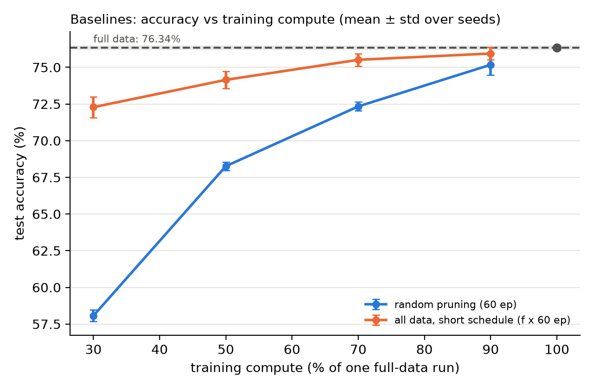
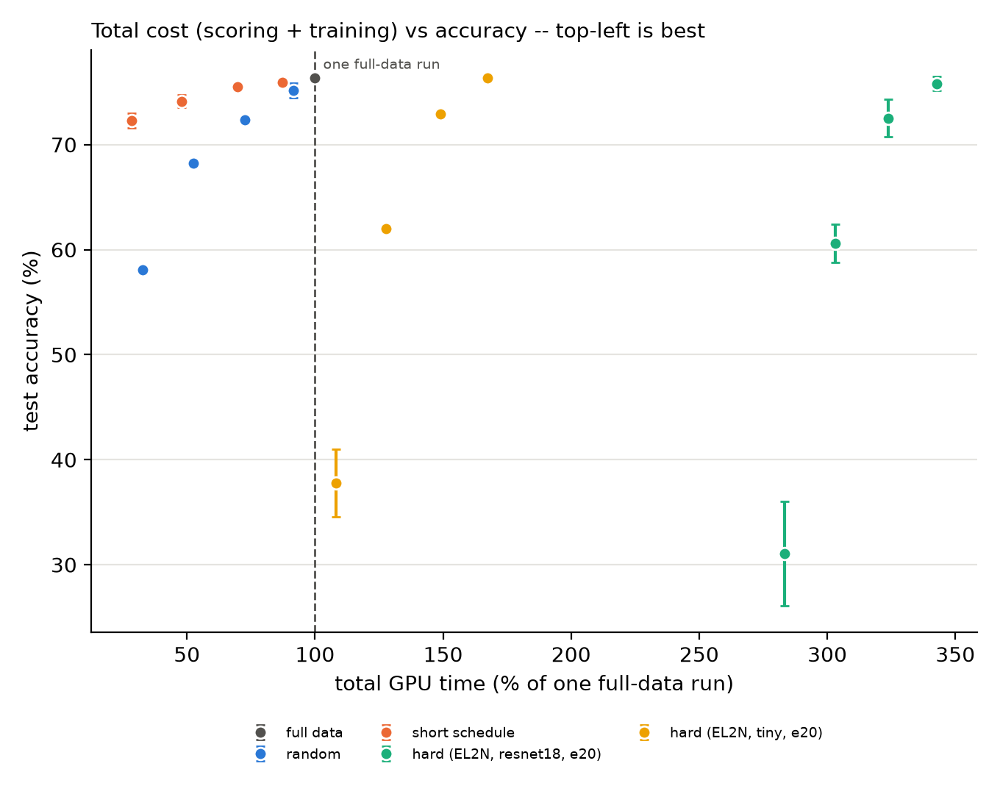
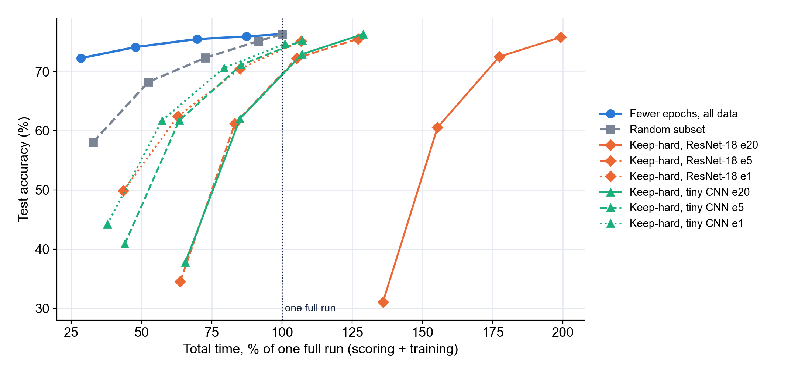
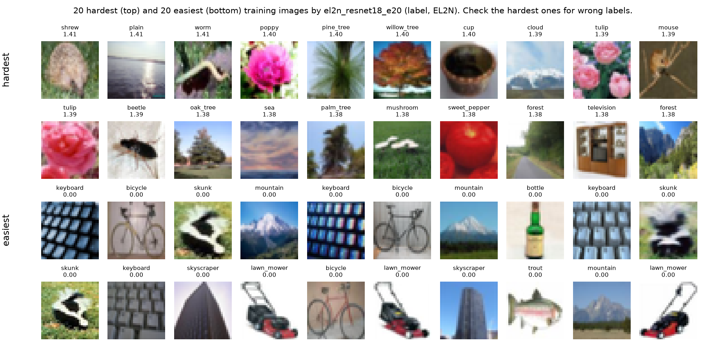
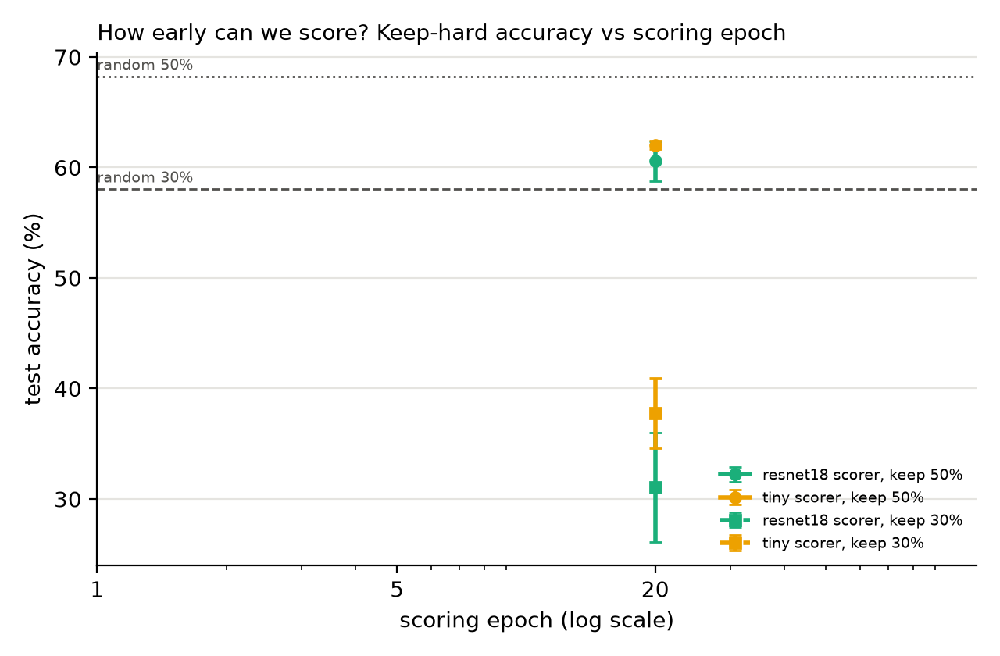
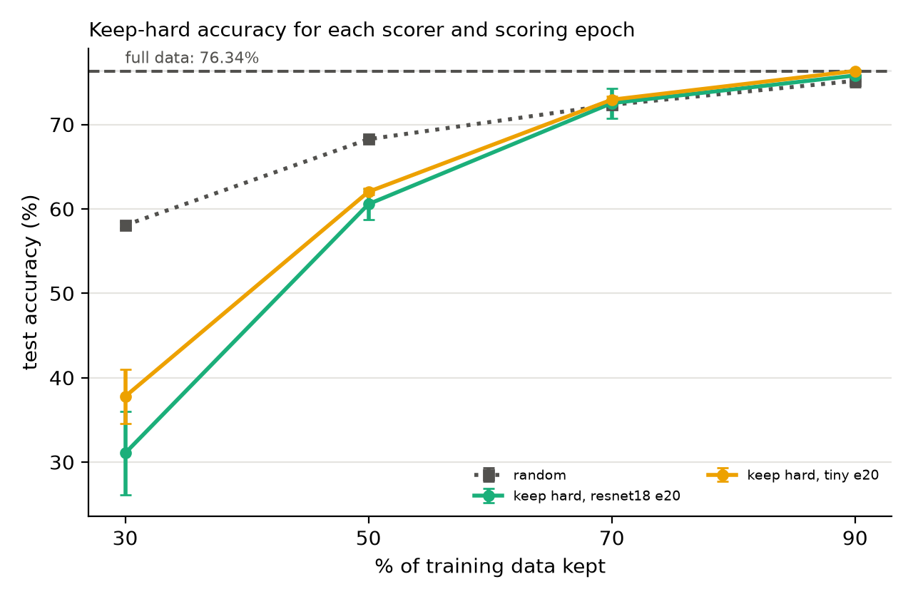
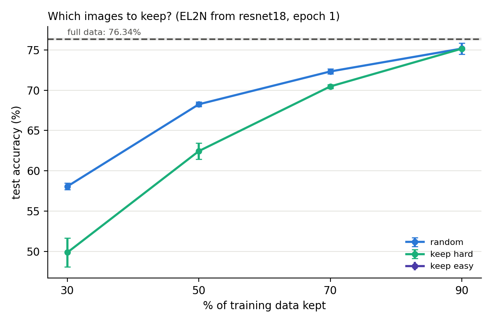
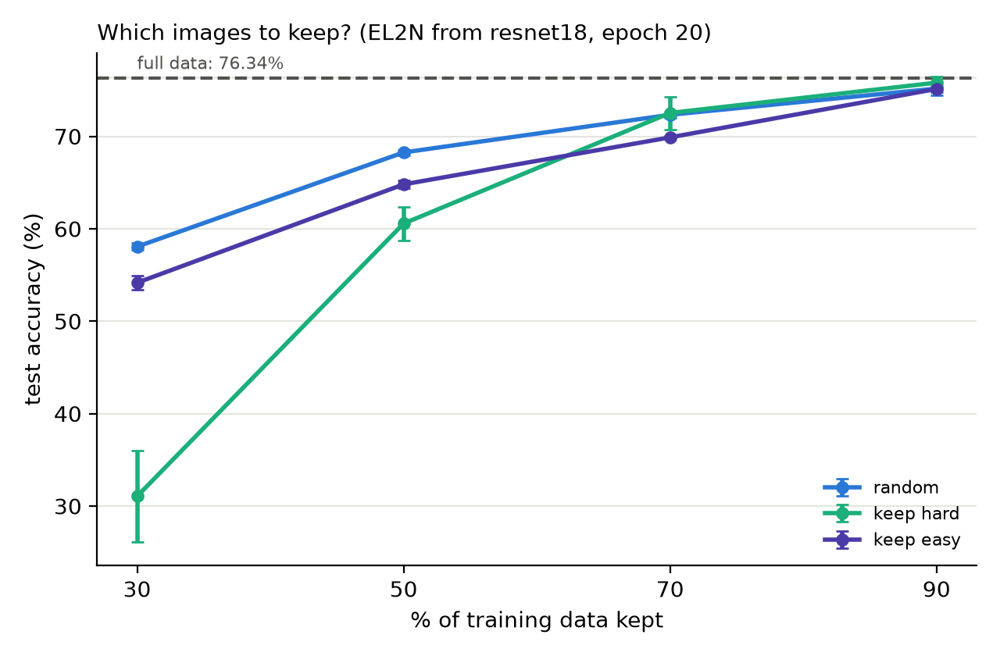
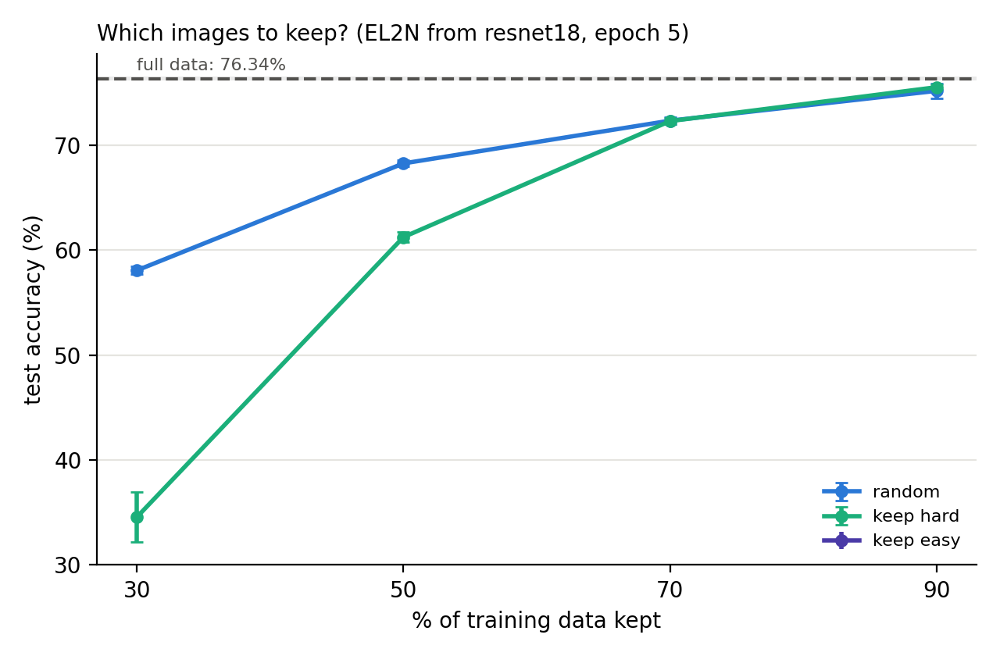
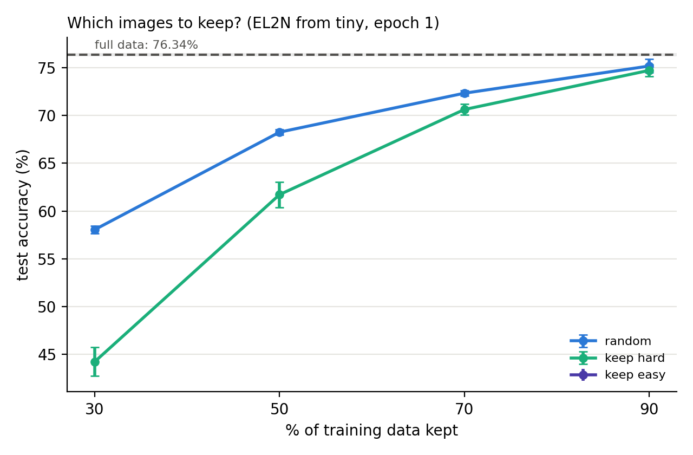
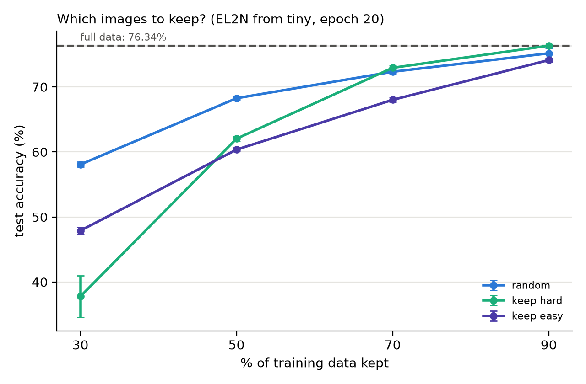
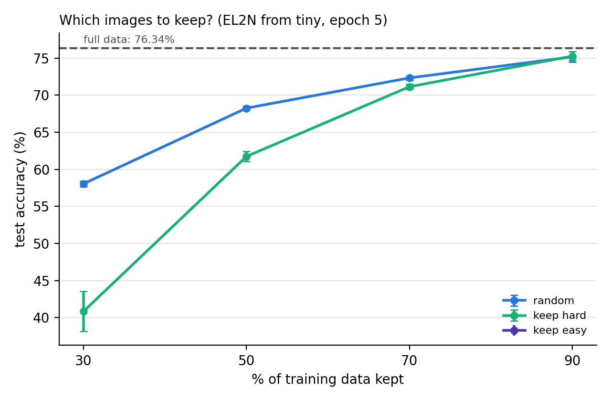
